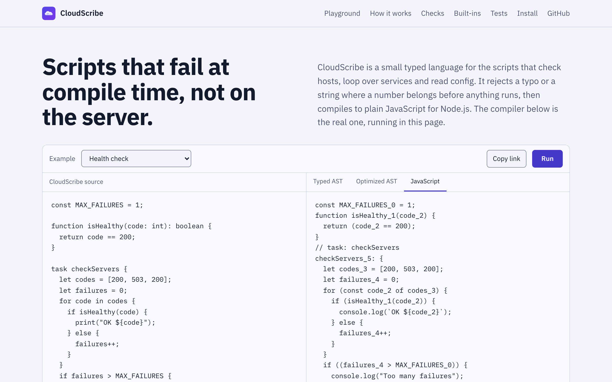
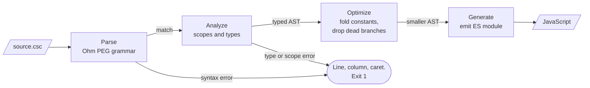

<p align="center">
  
</p>

<h1 align="center">CloudScribe</h1>

<p align="center">
  A statically typed scripting language for IT automation. Its compiler catches type and scope errors<br>
  before anything runs, then emits readable JavaScript. Grammar to code generator in about 1,600 lines.
</p>

<p align="center">
  <a href="https://github.com/patrickking67/cloudscribe/actions/workflows/ci.yml"></a>
  <a href="LICENSE"></a>
  <a href="#quality"></a>
  <a href="https://patrickking67.github.io/cloudscribe/"></a>
</p>

<table>
<tr><th>disk.csc</th><th>Compiles to</th></tr>
<tr>
<td>

```csc
const LIMIT = 80;

function overLimit(used: int): boolean {
  return used > LIMIT;
}

task diskCheck {
  let usage = [42, 91, 67];
  for used in usage {
    if overLimit(used) {
      print("${used}% is over the limit");
    }
  }
}
```

</td>
<td>

```js
const LIMIT_0 = 80;
function overLimit_1(used_2) {
  return (used_2 > LIMIT_0);
}
// task: diskCheck
{
  let usage_3 = [42, 91, 67];
  for (const used_2 of usage_3) {
    if (overLimit_1(used_2)) {
      console.log(`${used_2}% is over the limit`);
    }
  }
}
```

</td>
</tr>
</table>

Write the readings as strings, `["42", "91", "67"]`, and the type checker stops the build before any JavaScript exists:

```text
$ npx cloudscribe disk.csc --check
error: disk.csc: Line 10, col 18:
   9 |   for used in usage {
> 10 |     if overLimit(used) {
                        ^~~~
  11 |       print("${used}% is over the limit");
Expected argument 1 of type int, got string
```

<p align="center">
  <a href="https://patrickking67.github.io/cloudscribe/">
    <picture>
      <source media="(prefers-color-scheme: dark)" srcset="docs/assets/playground-dark.png">
      
    </picture>
  </a>
</p>

## Try it

**[Open the playground](https://patrickking67.github.io/cloudscribe/).** The same compiler runs in the page. Edit a program, switch between the typed AST, the optimized AST and the JavaScript, run it, and copy a link that carries your code.

Or locally, with [Node.js](https://nodejs.org/) 20 or later:

```bash
git clone https://github.com/patrickking67/cloudscribe.git
cd cloudscribe && npm ci
npx cloudscribe examples/disk_report.csc --check   # type-check only
npx cloudscribe examples/disk_report.csc           # print the JavaScript
npx cloudscribe examples/disk_report.csc --run     # compile and run
```

`npm link` puts `cloudscribe` on your path. The package is not published to the npm registry.

## What is technically interesting here

- **Errors point at the exact code.** Every type and scope rule goes through one `must` helper in [`src/analyzer.js`](src/analyzer.js) that attaches the line, column and a caret excerpt from the parser. Each rule has a test with its message in [`test/analyzer.test.js`](test/analyzer.test.js).
- **Only two stages can fail.** The parser and analyzer reject bad programs. The optimizer and generator then work on a tree that is known to be well typed, so they have no error paths for user code ([`src/compiler.js`](src/compiler.js)).
- **Folding that keeps scopes intact.** Replacing `if true { let y = 2; }` with its body would leak `y` into the outer scope and can produce a JavaScript `SyntaxError`. `keepScope` in [`src/optimizer.js`](src/optimizer.js) wraps the surviving branch in a block only when it declares names, and [`test/compiler.test.js`](test/compiler.test.js) runs the result.
- **`return` in a task becomes a labeled `break`.** A task compiles to a block, where `return` is illegal. The generator adds the label after the fact, and only to tasks that return early ([`src/generator.js`](src/generator.js)).
- **One compiler, two hosts, no drift.** The playground runs a generated browser copy of `src/`. [`test/playground.test.js`](test/playground.test.js) fails if the copy is stale or compiles any example differently from the CLI.
- **Output is tested by running it.** Every program in [`examples/`](examples) is compiled, executed in an empty directory and compared with its expected output ([`test/examples.test.js`](test/examples.test.js)).

## Architecture



| Stage | File | What it does |
|-------|------|--------------|
| Grammar | [`src/cloudscribe.ohm`](src/cloudscribe.ohm) | PEG grammar for [Ohm](https://ohmjs.org/), with operator precedence encoded in the rules |
| Parse | [`src/parser.js`](src/parser.js) | Matches source against the grammar and reports syntax errors |
| Analyze | [`src/analyzer.js`](src/analyzer.js) | Resolves scopes, infers and checks types, builds the typed AST |
| Optimize | [`src/optimizer.js`](src/optimizer.js) | Folds numeric and boolean constants and literal parts of interpolated strings, removes dead branches and `while false` loops |
| Generate | [`src/generator.js`](src/generator.js) | Emits indented JavaScript, suffixes names so they never clash with reserved words, lowers tasks to blocks |

[`docs/architecture.md`](docs/architecture.md) follows one program through every stage, with the AST before and after optimization, and has the component and playground diagrams.

## The language

```csc
const configPath = env("CONFIG_PATH") ?? "config.json";
const retries = toInt(env("RETRIES") ?? "3") ?? 3;
```

- **Types:** `int`, `string`, `boolean`, arrays `[T]`, optionals `T?` and function types `(T) -> R`. Variables are inferred from their initializer; parameters and return types are declared.
- **Structure:** `task name { ... }` for workflows, `function name(x: T): R { ... }` for reusable logic, `let` and `const` bindings.
- **Control flow:** `if`/`else`, `while`, `for x in array`, `break`, `return`.
- **Strings:** interpolation with `"host ${name} returned ${code + 1}"`. Each embedded expression is type-checked.
- **Built-ins:** `print`, `env`, `readFile`, `writeFile`, `fileExists`, `toInt`, `shell`, `exit`. The ones that can come back empty return an optional, so the compiler makes you handle that case with `??`. Generated code includes support only for the built-ins a program uses.

The full rules, the operator table and every diagnostic are in the [language specification](docs/language-spec.md).

## Command line

```text
cloudscribe <file.csc> [stage] [--out <file>]
cloudscribe <file.csc> --check
cloudscribe <file.csc> --run [--out <file>]
```

| Option or stage | Result |
|-----------------|--------|
| (none) or `js` | Prints the generated JavaScript |
| `parsed` | Prints `Syntax is ok` or the syntax error |
| `analyzed` | Prints the typed AST |
| `optimized` | Prints the AST after constant folding |
| `--check` | Type-checks without generating code and prints `<file>: ok` |
| `--run` | Compiles and runs the program with Node.js in the current directory |
| `--out <file>` | Writes the output to a file (with `--run`, keeps the compiled file) |

Exit codes: `0` success, `1` syntax or type error, `2` bad arguments or a file that cannot be read or written. With `--run`, the exit code is the program's own.

## Quality

| Signal | Current state |
|--------|---------------|
| Tests | 285 tests in 11 files on Node's built-in runner. [`scripts/test.mjs`](scripts/test.mjs) fails if this number goes stale |
| Coverage of `src/` | 99.2% of lines, 95.8% of branches (Node's native coverage, Node 24) |
| CI | `npm run check` on Node 20, 22 and 24 for every push and pull request, with read-only permissions |
| Examples | 10 programs compiled, run and compared with expected output |
| Playground | Browser copy of the compiler checked against `src/` on every run |
| Site | No third-party scripts. Tested for local links, real quoted output and social card tags. Contrast, keyboard focus and the 375px layout were checked by hand |
| Supply chain | 2 runtime dependencies, lockfile respected, weekly Dependabot updates, [private vulnerability reporting](SECURITY.md) |

```bash
npm run check        # everything CI runs: repo checks, playground freshness, tests
npm test             # tests with the coverage report for src/
npm run test:only    # same tests, no coverage
```

## Project layout

```text
src/        compiler stages and the CLI
test/       node:test suites and expected example output
examples/   sample .csc programs, all compiled and run in tests
docs/       GitHub Pages site, playground, language spec, architecture notes
scripts/    playground build, test runner, repository checks
```

The site in `docs/` is static and has no build step. `.github/workflows/pages.yml` deploys it to GitHub Pages on every push to `main`, after running the same checks as CI. Preview it with `python3 -m http.server 4101 --directory docs`.

More detail: [AGENTS.md](AGENTS.md) for commands and conventions, [CONTRIBUTING.md](CONTRIBUTING.md), [SECURITY.md](SECURITY.md), [CHANGELOG.md](CHANGELOG.md).

## License

MIT, see [LICENSE](LICENSE). Written by [Patrick King](https://github.com/patrickking67).
