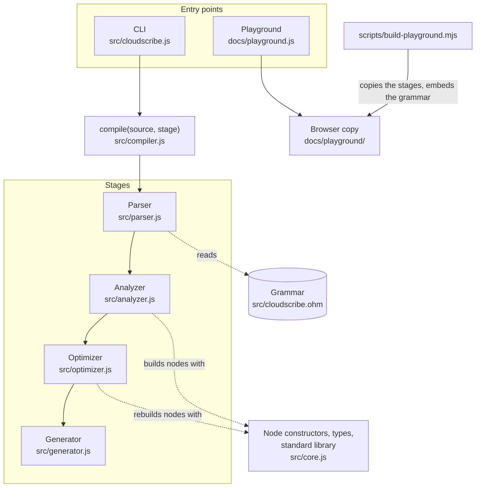
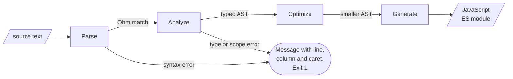
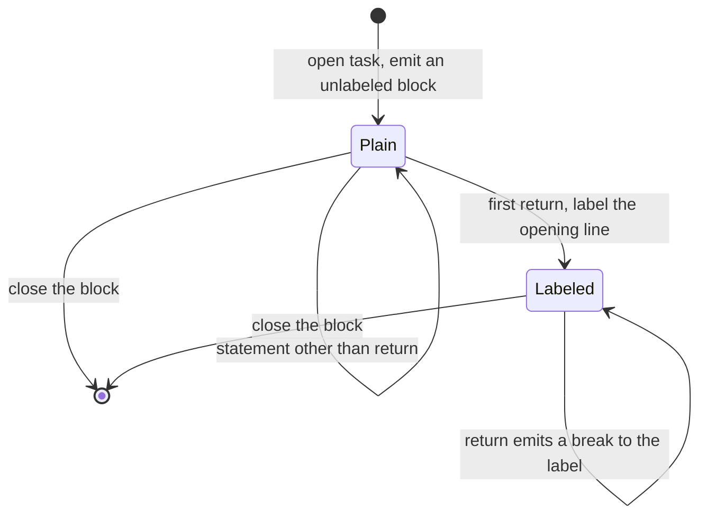
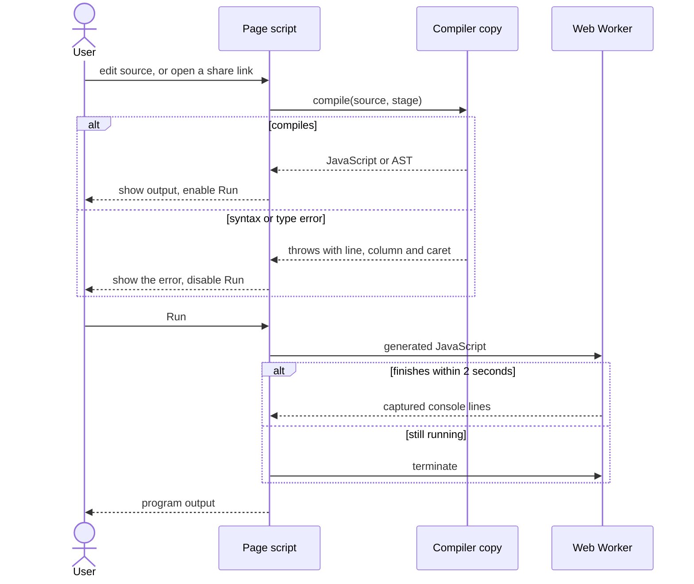

# Architecture

How CloudScribe turns a `.csc` file into JavaScript, stage by stage, with one program followed all the way through. The [README](../README.md) has the short version and the [language specification](language-spec.md) has the rules.

Every listing on this page is real output from the command shown above it.

## Components



What to notice: there is one compiler and two hosts. The CLI imports `src/` directly. The playground imports a generated copy in `docs/playground/`, and `npm run check` fails if that copy differs from what the build script would write. `src/core.js` is the one module the tree-building stages share, so the shape of every AST node is defined in one file.

## The pipeline



What to notice: only the first two stages can reject a program. Once the analyzer returns, the program is known to be well typed, so the optimizer and generator have no error paths for user code. `compile(source, stage)` in [`src/compiler.js`](../src/compiler.js) stops after the stage you ask for, which is how the CLI prints the tree at `analyzed` or `optimized` and how `--check` avoids generating code.

| Stage | Input | Output | Can reject a program |
|-------|-------|--------|----------------------|
| Parse | source text | Ohm match | yes, syntax errors |
| Analyze | Ohm match | typed AST | yes, every type and scope rule |
| Optimize | typed AST | AST with constants folded and dead branches removed | no |
| Generate | optimized AST | JavaScript text | no |

## One program through every stage

[`examples/constant_folding.csc`](../examples/constant_folding.csc):

```csc
// Shows what the optimizer does before any JavaScript is written.
// Compare the typed AST with the optimized AST in the playground.
const TIMEOUT = 5 * 60;

task patchHosts {
  let hosts = ["web-01", "db-01"];
  for host in hosts {
    print("${host}: timeout ${TIMEOUT}s, attempt ${1} of ${1 + 2}");
  }
  if 2 ** 10 < 1000 {
    print("unreachable");
  }
}
```

### 1. Parse

```text
$ npx cloudscribe examples/constant_folding.csc parsed
Syntax is ok
```

[`src/cloudscribe.ohm`](../src/cloudscribe.ohm) is a PEG grammar. Operator precedence is encoded as a ladder of rules, `Exp` down to `Exp11`, so `2 ** 10 < 1000` parses as `(2 ** 10) < 1000` with no precedence table anywhere else. The parser returns Ohm's match object; no tree is built yet. A syntax error is reported by Ohm with the line, the column and what it expected to see.

### 2. Analyze

```text
$ npx cloudscribe examples/constant_folding.csc analyzed
   1 | Program statements=[#2,#5]
   2 | VariableDeclaration variable=#3 initializer=#4
   3 | Variable name='TIMEOUT' mutable=false type='int'
   4 | BinaryExpression op='*' left=5 right=60 type='int'
   5 | TaskDeclaration task=#6
   6 | Task name='patchHosts' body=[#7,#11,#18]
   7 | VariableDeclaration variable=#8 initializer=#10
   8 | Variable name='hosts' mutable=true type=#9
   9 | ArrayType baseType='string'
  10 | ArrayExpression elements=['"web-01"','"db-01"'] type=#9
  11 | ForStatement iterator=#12 collection=#8 body=[#13]
  12 | Variable name='host' mutable=false type='string'
  13 | FunctionCall callee=#14 args=[#16] type='void'
  14 | Function name='print' type=#15 intrinsic=true
  15 | FunctionType paramTypes=['any'] returnType='void'
  16 | InterpolatedString strings=['',': timeout ','s, attempt ',' of ',''] expressions=[#12,#3,1,#17] type='string'
  17 | BinaryExpression op='+' left=1 right=2 type='int'
  18 | ShortIfStatement test=#19 consequent=[#21]
  19 | BinaryExpression op='<' left=#20 right=1000 type='boolean'
  20 | BinaryExpression op='**' left=2 right=10 type='int'
  21 | FunctionCall callee=#14 args=['"unreachable"'] type='void'
```

The analyzer walks the match with an Ohm semantics operation and builds the tree with the constructors in `src/core.js`. Each `#n` is a reference to the node on line `n`, so shared nodes are printed once.

What to notice:

- Line 4 is `5 * 60`, still a `BinaryExpression`, now with `type='int'`. Types are inferred from initializers, so `TIMEOUT` on line 3 is an `int` and `hosts` on line 8 is `[string]` without an annotation.
- Line 16 is the interpolated string. Its `expressions` hold references to the entities, not their names: `#12` is the loop variable `host` and `#3` is the constant `TIMEOUT`. Names are resolved here, once, and no later stage looks one up again.
- Line 12 has `mutable=false`: a loop variable cannot be assigned to, and that is enforced here.

Scopes are a chain of `Context` objects, each with a `Map` of local names and a link to its parent. The root context is seeded with the standard library. A function, a task, each branch of an `if` and each loop body get a child context. The context also records whether the code is inside a loop, a function or a task, which is how `break` outside a loop and `return` outside a function or task are rejected. Every check goes through one `must(condition, message, location)` helper that prefixes the message with Ohm's line, column and caret excerpt.

### 3. Optimize

```text
$ npx cloudscribe examples/constant_folding.csc optimized
   1 | Program statements=[#2,#4]
   2 | VariableDeclaration variable=#3 initializer=300
   3 | Variable name='TIMEOUT' mutable=false type='int'
   4 | TaskDeclaration task=#5
   5 | Task name='patchHosts' body=[#6,#11]
   6 | VariableDeclaration variable=#7 initializer=#9
   7 | Variable name='hosts' mutable=true type=#8
   8 | ArrayType baseType='string'
   9 | ArrayExpression elements=['"web-01"','"db-01"'] type=#10
  10 | ArrayType baseType='string'
  11 | ForStatement iterator=#12 collection=#7 body=[#13]
  12 | Variable name='host' mutable=false type='string'
  13 | FunctionCall callee=#14 args=[#16] type='void'
  14 | Function name='print' type=#15 intrinsic=true
  15 | FunctionType paramTypes=['any'] returnType='void'
  16 | InterpolatedString strings=['',': timeout ','s, attempt 1 of 3'] expressions=[#12,#3] type='string'
```

What changed:

- `5 * 60` is gone. Line 2 now reads `initializer=300`.
- The interpolated string on line 16 went from four expressions to two. `${1}` and `${1 + 2}` were folded and moved into the surrounding text, leaving `'s, attempt 1 of 3'`.
- The `if 2 ** 10 < 1000` statement is gone. `2 ** 10` folded to `1024`, the comparison folded to `false`, and an `if` with a constant false test and no `else` is removed with its body.

The optimizer is a table of visitor functions keyed by node kind. It folds numeric and boolean literals only. A constant such as `TIMEOUT` is not propagated into its uses, which is why `${TIMEOUT}` survives as an expression.

### 4. Generate

```text
$ npx cloudscribe examples/constant_folding.csc
const TIMEOUT_0 = 300;
// task: patchHosts
{
  let hosts_1 = ["web-01", "db-01"];
  for (const host_2 of hosts_1) {
    console.log(`${host_2}: timeout ${TIMEOUT_0}s, attempt 1 of 3`);
  }
}
```

What to notice: every name gets a numeric suffix, so a CloudScribe identifier can never collide with a JavaScript reserved word. A `const` stays a `const`, a task becomes a block, and the interpolated string becomes a template literal. Running it:

```text
$ npx cloudscribe examples/constant_folding.csc --run
web-01: timeout 300s, attempt 1 of 3
db-01: timeout 300s, attempt 1 of 3
```

## Two details worth reading

### A folded branch keeps its scope

When an `if` has a constant test, the optimizer replaces the statement with the surviving branch. Splicing that branch straight into the enclosing block would move its declarations into the outer scope, where a later declaration of the same name is a JavaScript `SyntaxError`:

```csc
if true { let y = 2; print(y); } else { print(0); }
let y = 3;
```

`keepScope` in [`src/optimizer.js`](../src/optimizer.js) wraps a surviving branch in a `Block` when it declares anything and splices it flat when it does not. The tests are "keeps a folded branch in its own block when it declares names" in `test/optimizer.test.js` and "does not leak declarations from a folded if branch into the outer scope" in `test/compiler.test.js`, which runs the generated code.

### `return` inside a task

A task compiles to a JavaScript block, and `return` is illegal in a block. The generator lowers it to a labeled `break`, and adds the label only to tasks that need one:



What to notice: the label is decided while the body is being generated, by rewriting the task's opening line in the output buffer once the body is done. A `return` inside a function that is nested in a task still compiles to a real `return`, because the generator keeps a stack of return targets and only the innermost one counts. See `taskLabel` in [`src/generator.js`](../src/generator.js) and the README example, where `return;` becomes `break checkServers_5;`.

## The playground



The page script is `docs/playground.js` and the compiler copy is `docs/playground/`. What to notice: compiling happens on the main thread on every edit, and running happens in a throwaway worker that is terminated after two seconds, so an endless loop cannot freeze the page. Nothing is sent to a server. The site is static files.

Share links put the program in the URL fragment as `#code=` followed by unpadded base64url of the UTF-8 source ([`docs/share.js`](share.js)). The fragment is input from outside, so it is handled as such:

- Decoding returns `null` for anything that is not base64url or not valid UTF-8, and for programs over 8,000 characters. A damaged link falls back to the default example.
- The decoded text goes into the editor and the compiler, and output is written to the page with `textContent`. Nothing runs until someone presses Run.
- Programs that use `env`, files, the shell or `exit` are compiled but not run in the browser.

The worker is there to keep the page responsive, not to contain hostile code: the page holds no credentials, cookies or user data for a program to reach. `test/share.test.js` covers the encoding, including damaged input.

## How the tests are arranged

| Suite | What it proves |
|-------|----------------|
| `test/parser.test.js` | The grammar accepts valid programs and rejects invalid ones |
| `test/analyzer.test.js` | Each type and scope rule, with its message |
| `test/optimizer.test.js` | Paired input and output trees for each fold |
| `test/generator.test.js` | Emitted text for each node kind |
| `test/compiler.test.js` | The whole pipeline, including running generated code |
| `test/cli.test.js` | Options, output files and the three exit codes |
| `test/stdlib.test.js` | Each built-in, run in a subprocess |
| `test/examples.test.js` | Every example compiled, run and compared with its expected output |
| `test/playground.test.js` | The browser copy matches `src/` and compiles every example identically |
| `test/share.test.js` | Share link encoding and decoding |
| `test/site.test.js` | Site examples compile, quoted compiler output is real, local links resolve |

`npm run check` runs all of it, then compares the number of tests that ran with the count printed in the README, the site and `llms.txt`.
